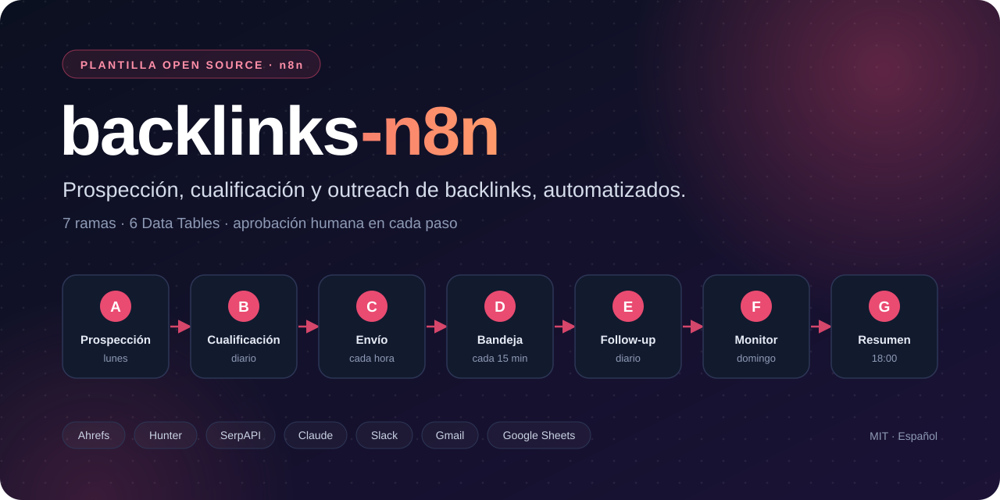
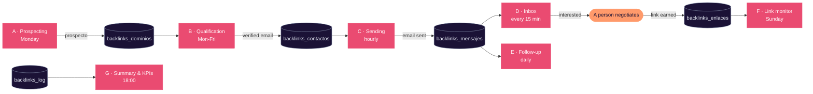

<p align="center">
  
</p>

<p align="center">
  <a href="LICENSE"></a>
  <a href="https://n8n.io"></a>
  <a href="https://www.anthropic.com/claude"></a>
  
</p>

<p align="center">
  <a href="README.md">Español</a> · <b>English</b>
</p>

**backlinks-n8n** is an n8n template that automates the repetitive part of a backlink campaign:
it finds relevant websites, decides which ones are worth it, looks for who to write to, prepares
the emails, reads the replies and keeps an eye on the links you earn.

People keep what should not be automated: **approving every website and every email, and talking
to whoever replies with interest.** Nothing is sent without human approval.

- **7 branches** in a single workflow, each with its own schedule.
- **Reusable:** everything about the business lives in one configuration row; nothing is
  hard-coded in the nodes.
- **Filters from cheap to expensive**, so API credits are not wasted on websites that will be
  discarded anyway.
- **Safe by default:** while `modo_prueba` (test mode) is on, no email reaches a real person.

> **Language note:** the workflow (node names, prompts, Slack messages) and the detailed
> documentation in [`docs/`](docs/) are in **Spanish**. The emails themselves are translated by the
> AI into each contact's language.

## Contents

- [How it works](#how-it-works)
- [Requirements](#requirements)
- [Quick start](#quick-start)
- [Configuration](#configuration)
- [Safety and control](#safety-and-control)
- [Day-to-day operation](#day-to-day-operation)
- [Repository structure](#repository-structure)
- [Documentation](#documentation)
- [Contributing](#contributing)
- [License](#license)

## How it works

Everything lives in **one n8n workflow called `Backlinks`**, split into 7 branches. The branches
are not wired to each other: they hand work over through the **status** of each row in the Data
Tables, like an assembly line.



| Branch | When | What it does |
|---|---|---|
| [**A · Prospecting**](docs/branches/rama-a-prospeccion.md) | Monday, 3:00 | Finds websites that mention the brand, link to competitors, have broken links to competitors or accept contributions. Suggests blog posts as linkable resources |
| [**B · Qualification**](docs/branches/rama-b-cualificacion.md) | Mon-Fri, 4:00 | Drops sites that already link, weak sites, off-topic or wrong-language sites and link farms. Segments them (large press, small press, SMB), asks for approval in Slack and finds and verifies the email with Hunter |
| [**C · Sending**](docs/branches/rama-c-envio.md) | Hourly, within `ventana_envio` | Prepares each contact's first email, sends it for approval in Slack and sends the approved ones via Gmail |
| [**D · Inbox**](docs/branches/rama-d-bandeja.md) | Every 15 min | Reads only our own threads, classifies each reply with AI and flags the important ones with a draft answer |
| [**E · Follow-up**](docs/branches/rama-e-follow-up.md) | Daily, 10:00 | Up to 2 reminders in the same thread to those who did not reply, approved in Slack |
| [**F · Link monitor**](docs/branches/rama-f-monitor.md) | Sunday, 7:00 | Checks that earned links are still live and alerts if one is lost |
| [**G · Summary & KPIs**](docs/branches/rama-g-resumen.md) | Daily, 18:00 | Daily numbers in Slack (cumulative KPIs on Fridays) and deletion of old personal data |

There are also two helper workflows: [`Errores en backlinks`](docs/branches/workflow-errores.md),
which alerts in Slack when something fails, and `Test APIs`, which checks in one run that every
connection responds, without spending credits.

## Requirements

| What | Why |
|---|---|
| **n8n 2.x** with Data Tables | Tested with 2.47.7. Cloud, self-hosted or local with Docker |
| **Node.js 18+** | Only for the script that prepares the workflows before importing them |
| **Ahrefs** (API) | Website metrics, who links to competitors, broken links |
| **Hunter** | Find and verify each website's email |
| **SerpAPI** | Google searches: brand mentions and "write for us" pages |
| **Anthropic** (Claude) | Topical relevance, emails, reply classification |
| **Slack** | Alerts and approval forms |
| **Gmail** and **Google Sheets** | Sending and reading emails; linkable resources and the PR list |

## Quick start

> **Using an AI assistant?** Open the repo with Claude Code, Codex or Cursor and type
> *"Help me install backlinks-n8n"*. The [AGENTS.md](AGENTS.md) file gives it the context to guide
> you step by step, asking questions and checking each step on your machine.

```bash
git clone https://github.com/angeldanielseospecialist/backlinks-n8n.git
cd backlinks-n8n
```

1. **Create the 6 Data Tables** in n8n with the columns and types in
   [`data-tables/schema.json`](data-tables/schema.json).
2. **Add one row to `backlinks_config`** with your company's data, starting from
   [`config-plantilla.csv`](data-tables/config-plantilla.csv). Keep `modo_prueba = true`.
3. **Prepare the workflows with your IDs:** copy `data-tables/ids.example.json` to
   `data-tables/ids.local.json`, write each table's ID and run:

   ```bash
   node scripts/prepare-import.mjs
   ```

4. **Import** the files in `dist/` into n8n (⋮ → *Import from File*), in this order:
   `errores-backlinks.json`, `backlinks.json` and `test-apis.json`.
5. **Create the credentials and the Google Sheet**, assign them in the nodes and run `Test APIs`.

The full guide, including the 8 credentials and the Google Sheet, is in
[**docs/instalacion.md**](docs/instalacion.md) (Spanish).

## Configuration

Everything that changes from one company to another lives in **the single row** of
`backlinks_config`. The most important columns:

| Column | What it controls |
|---|---|
| `negocio_nombre` · `negocio_dominio` | Who you are and which domain you want links to |
| `tematica` · `idiomas` | What the business is about (the AI judges relevance against it) and which languages are accepted |
| `competidores` · `busquedas_serpapi` | Where candidate websites come from |
| `umbral_*` · `gran_prensa_*` · `pyme_dr_*` | Quality thresholds and segments |
| `limite_diario` · `ventana_envio` · `dias_follow_up` | How many emails, when, and how often to follow up |
| `mailbox` · `firma_email` · `texto_baja` | Sending mailbox, signature and unsubscribe notice |
| `modo_prueba` · `email_pruebas` | The safety switch: while on, everything goes to the test mailbox |

All 35 columns are explained in [docs/tables/backlinks_config.md](docs/tables/backlinks_config.md).

## Safety and control

- **Nothing is sent without human approval:** every website (branch B), every first email
  (branch C) and every reminder (branch E) goes through a Slack form.
- **`modo_prueba`** must be a `boolean` column. Real people are only contacted when it is exactly
  `false`.
- **Interested contacts are handled by a person:** the automation only leaves a draft.
- **Anyone who unsubscribes or asks for money** goes to the block list and is never contacted
  again. Their personal data is deleted automatically after 15 days.
- **Before sending real emails**, review the
  [cold email conditions](docs/condiciones-email-frio.md) with your legal advisor.

### Kill switch: how to stop everything if something goes wrong

**Stop:**
1. **Everything, in seconds:** in the `Backlinks` workflow, turn the *Active/Publish* switch (top
   right) OFF. Then, in *Executions*, filter by *Waiting* and stop those waiting for a Slack form.
   The link submission form also stops working while it is off.
2. **Emails only:** set `limite_diario = 0` in the config. Branch C drafts nothing and branch E
   sends no reminders; everything else keeps running.
3. **These do not work as brakes:** `limite_cualificacion_diario = 0` (it could read every
   website) and `modo_prueba` on (contacts are still marked as sent).

**Fix and restart:**
1. Find out what happened: the error alert in Slack (branch, node and message), the execution in
   *Executions*, and `Test APIs` to rule out an expired key or an exhausted balance.
2. Fix the node or the cell and compare the result with the repo version:

   ```bash
   node scripts/compare.mjs workflows/backlinks.json <your-export>.json
   ```

3. If you changed the config to stop it, restore the original value.
4. Reactivate the workflow and check the next execution.

## Day-to-day operation

What to keep an eye on while the automation is running:

- **Regular checks:** in n8n, the *Executions* of `Backlinks`: failed executions or ones left
  waiting. And the alerts in the Slack channel.
- **Deliverability:** bounces below 3 % and no complaints, because the mailbox affects the
  reputation of the company's domain. If all goes well for a few weeks, raise `limite_diario`
  gradually and review `limite_cola_prospectos`.
- **Spending:** check Anthropic, Ahrefs, SerpAPI and Hunter usage against each plan. Hunter is
  usually the bottleneck: if it falls short, consider a higher plan.

## Repository structure

```
backlinks-n8n/
├── workflows/        The 3 workflows, with placeholders instead of IDs
├── data-tables/      schema.json (tables and types), template config and ids.example.json
├── scripts/          prepare-import.mjs (builds dist/) and compare.mjs
├── src/              The workflow's 36 prompts and Code nodes, one file each
├── docs/             Architecture, installation, branches, tables and guides (Spanish)
├── AGENTS.md         Context for AI assistants working with the repo
├── CONTRIBUTING.md   How to report issues and submit changes
├── ROADMAP.md        Planned improvements to the automation
└── LICENSE
```

## Documentation

The detailed documentation is in Spanish:

| Document | Contents |
|---|---|
| [Instalación](docs/instalacion.md) | Step-by-step installation, credentials and Google Sheet |
| [Arquitectura](docs/arquitectura.md) | State machine, data rules and underlying risks |
| [Ramas](docs/branches/README.md) | What each branch does, step by step |
| [Tablas](docs/tables/README.md) | What each Data Table and column stores |
| [Google Sheet](docs/google-sheet.md) | The 3 tabs shared with marketing |
| [Condiciones del email en frío](docs/condiciones-email-frio.md) | Who gets emailed, what each email contains, unsubscribes |
| [Manual del canal de Slack](docs/manual-slack.md) | Ready-to-pin text for the team's Slack channel |
| [Desarrollo](docs/desarrollo.md) | How to modify the workflow and contribute changes |
| [Roadmap](ROADMAP.md) | Planned improvements to the automation |

## Contributing

Contributions are welcome. Read the [contributing guide](CONTRIBUTING.md) before opening an issue
or a pull request: pull requests target the `develop` branch, and workflows in the repo must use
placeholders instead of IDs and **must not contain data from your instance** (emails, domains, IDs
or credentials).

## License

[MIT](LICENSE) © 2026 [Angel Daniel Gutierrez Quiroga](https://github.com/angeldanielseospecialist)

> This template is not legal advice. Each company is responsible for complying with the
> applicable commercial communications and data protection laws before sending real emails.
