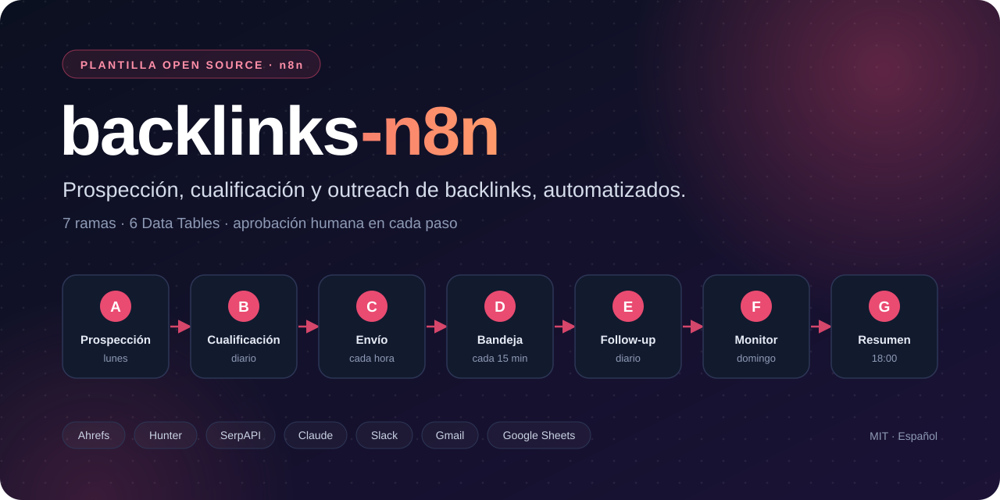
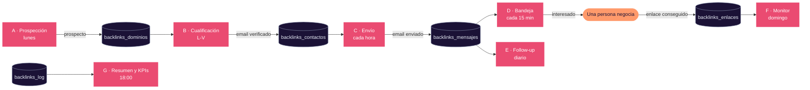

<p align="center">
  
</p>

<p align="center">
  <a href="LICENSE"></a>
  <a href="https://n8n.io"></a>
  <a href="https://www.anthropic.com/claude"></a>
  
</p>

<p align="center">
  <b>Español</b> · <a href="README.en.md">English</a>
</p>

**backlinks-n8n** es una plantilla de n8n que automatiza la parte repetitiva de una campaña de
backlinks: encuentra webs afines, decide cuáles valen la pena, busca a quién escribir, prepara
los emails, lee las respuestas y vigila los enlaces conseguidos.

Las personas se quedan con lo que no conviene automatizar: **aprobar cada web y cada email, y
hablar con quien responde con interés.** Nada sale sin aprobación humana.

- **7 ramas** en un solo workflow, cada una con su horario.
- **Reutilizable:** todo lo del negocio vive en una fila de configuración, ningún dato está
  escrito en los nodos.
- **Filtra de lo barato a lo caro**, para no gastar créditos de APIs en webs que se van a
  descartar.
- **Seguro por defecto:** con `modo_prueba` activado, ningún email llega a una persona real.

## Índice

- [Cómo funciona](#cómo-funciona)
- [Requisitos](#requisitos)
- [Instalación rápida](#instalación-rápida)
- [Configuración](#configuración)
- [Seguridad y control](#seguridad-y-control)
- [Operación diaria](#operación-diaria)
- [Estructura del repositorio](#estructura-del-repositorio)
- [Documentación](#documentación)
- [Contribuir](#contribuir)
- [Licencia](#licencia)

## Cómo funciona

Todo vive en **un workflow de n8n llamado `Backlinks`**, dividido en 7 ramas. Las ramas no se
conectan con cables: se pasan el trabajo a través del **estado** de cada fila en las Data
Tables, como una cinta de montaje.



| Rama | Cuándo | Qué hace |
|---|---|---|
| [**A · Prospección**](docs/branches/rama-a-prospeccion.md) | Lunes, 3:00 | Busca webs que mencionan la marca, que enlazan a la competencia, con enlaces rotos de la competencia o que aceptan colaboraciones. Propone posts del blog como recursos enlazables |
| [**B · Cualificación**](docs/branches/rama-b-cualificacion.md) | L-V, 4:00 | Descarta las que ya enlazan, las flojas, las de otra temática o idioma y las granjas. Segmenta (gran prensa, pequeña prensa, pyme), pide el visto bueno en Slack y busca y verifica el email con Hunter |
| [**C · Envío**](docs/branches/rama-c-envio.md) | Cada hora, en `ventana_envio` | Prepara el primer email de cada contacto, lo manda a aprobar en Slack y envía los aprobados por Gmail |
| [**D · Bandeja de entrada**](docs/branches/rama-d-bandeja.md) | Cada 15 min | Lee solo nuestros hilos, clasifica cada respuesta con IA y avisa de las que importan, con un borrador de respuesta |
| [**E · Follow-up**](docs/branches/rama-e-follow-up.md) | Diario, 10:00 | Hasta 2 recordatorios en el mismo hilo a quien no contestó, aprobados en Slack |
| [**F · Monitor de enlaces**](docs/branches/rama-f-monitor.md) | Domingo, 7:00 | Comprueba que los enlaces conseguidos siguen vivos y avisa si se pierde alguno |
| [**G · Resumen y KPIs**](docs/branches/rama-g-resumen.md) | Diario, 18:00 | Números del día en Slack (los viernes, KPIs acumulados) y borrado de los datos personales antiguos |

Además hay dos workflows de apoyo: [`Errores en backlinks`](docs/branches/workflow-errores.md), que
avisa en Slack cuando algo falla, y `Test APIs`, que comprueba de una pasada que todas las
conexiones responden sin gastar créditos.

## Requisitos

| Qué | Para qué |
|---|---|
| **n8n 2.x** con Data Tables | Probado con la 2.47.7. En la nube, en un servidor propio o en local con Docker |
| **Node.js 18+** | Solo para el script que prepara los workflows antes de importarlos |
| **Ahrefs** (API) | Métricas de cada web, quién enlaza a la competencia y enlaces rotos |
| **Hunter** | Buscar y verificar el email de cada web |
| **SerpAPI** | Búsquedas en Google: menciones de marca y "escribe para nosotros" |
| **Anthropic** (Claude) | Relevancia temática, emails, clasificación de respuestas |
| **Slack** | Avisos y formularios de aprobación |
| **Gmail** y **Google Sheets** | Enviar y leer los emails; recursos enlazables y lista para PR |

## Instalación rápida

> **¿Usas un asistente de IA?** Abre el repo con Claude Code, Codex o Cursor y escribe
> *"Ayúdame a instalar backlinks-n8n"*. El archivo [AGENTS.md](AGENTS.md) le da el contexto para
> guiarte paso a paso, con preguntas y comprobando cada paso en tu equipo.

```bash
git clone https://github.com/angeldanielseospecialist/backlinks-n8n.git
cd backlinks-n8n
```

1. **Crea las 6 Data Tables** en n8n con las columnas y tipos de
   [`data-tables/schema.json`](data-tables/schema.json).
2. **Añade una fila a `backlinks_config`** con los datos de tu empresa, partiendo de
   [`config-plantilla.csv`](data-tables/config-plantilla.csv). Deja `modo_prueba = true`.
3. **Prepara los workflows con tus IDs:** copia `data-tables/ids.example.json` como
   `data-tables/ids.local.json`, escribe el ID de cada tabla y ejecuta:

   ```bash
   node scripts/prepare-import.mjs
   ```

4. **Importa** los archivos de `dist/` en n8n (⋮ → *Import from File*), en este orden:
   `errores-backlinks.json`, `backlinks.json` y `test-apis.json`.
5. **Crea las credenciales y el Google Sheet**, asígnalos en los nodos y ejecuta `Test APIs`.

La guía completa, con las 8 credenciales y el Google Sheet, está en
[**docs/instalacion.md**](docs/instalacion.md).

## Configuración

Todo lo que cambia de una empresa a otra está en **la única fila** de `backlinks_config`. Las más
importantes:

| Columna | Qué controla |
|---|---|
| `negocio_nombre` · `negocio_dominio` | Quién eres y qué dominio quieres que enlacen |
| `tematica` · `idiomas` | De qué va el negocio (la IA juzga la afinidad con esto) y en qué idiomas se escribe |
| `competidores` · `busquedas_serpapi` | De dónde salen las webs candidatas |
| `umbral_*` · `gran_prensa_*` · `pyme_dr_*` | Los listones de calidad y los segmentos |
| `limite_diario` · `ventana_envio` · `dias_follow_up` | Cuántos emails, cuándo y cada cuánto se recuerda |
| `mailbox` · `firma_email` · `texto_baja` | Desde dónde se escribe, la firma y el aviso de baja |
| `modo_prueba` · `email_pruebas` | El seguro: mientras esté activado, todo va al buzón de pruebas |

La explicación de las 35 columnas está en
[docs/tables/backlinks_config.md](docs/tables/backlinks_config.md).

## Seguridad y control

- **Nada sale sin aprobación humana:** cada web (rama B), cada primer email (rama C) y cada
  recordatorio (rama E) pasan por un formulario en Slack.
- **`modo_prueba`** tiene que ser de tipo `boolean`. Solo se escribe a personas reales cuando vale
  exactamente `false`.
- **Los interesados los atiende una persona:** la automatización solo deja un borrador.
- **Quien pide la baja o dinero** pasa a la lista de bloqueo y no se le vuelve a escribir. Sus
  datos personales se borran solos a los 15 días.
- **Antes de enviar emails reales**, revisa las
  [condiciones del email en frío](docs/condiciones-email-frio.md) con tu asesoría legal.

### Interruptor: cómo pararlo todo si algo falla

**Parar:**
1. **Todo, en segundos:** en el workflow `Backlinks`, pon el interruptor *Active/Publish* de arriba
   a la derecha en OFF. Después, en *Executions*, filtra por *Waiting* y para las que esperan un
   formulario de Slack. El formulario de altas también deja de funcionar mientras esté apagado.
2. **Solo los emails:** `limite_diario = 0` en la config. La rama C no redacta nada y la E no manda
   recordatorios; lo demás sigue.
3. **No sirven como freno:** `limite_cualificacion_diario = 0` (podría leer todas las webs) ni
   `modo_prueba` activado (los contactos quedan como enviados igualmente).

**Arreglar y volver a encender:**
1. Mira qué pasó: el aviso de error en Slack (dice la rama, el nodo y el mensaje), la ejecución en
   *Executions* y `Test APIs` para descartar una clave o un saldo agotado.
2. Corrige el nodo o la celda y compara el resultado con la versión del repo:

   ```bash
   node scripts/compare.mjs workflows/backlinks.json <tu-exportación>.json
   ```

3. Si tocaste la config para frenar, devuélvela a su valor.
4. Vuelve a activar el workflow y mira la siguiente ejecución.

## Operación diaria

Lo que hay que vigilar con la automatización en marcha:

- **Controles periódicos:** en n8n, *Executions* de `Backlinks`: las ejecuciones con error o que se
  quedaron esperando. Y los avisos del canal de Slack.
- **Entregabilidad:** rebotes por debajo del 3 % y ninguna queja, porque el buzón afecta a la
  reputación del dominio de la empresa. Si todo va bien unas semanas, sube `limite_diario` poco a
  poco y revisa `limite_cola_prospectos`.
- **Gasto:** revisa el consumo de Anthropic, Ahrefs, SerpAPI y Hunter frente al plan de cada uno.
  El recurso escaso suele ser Hunter: si se queda corto, valora un plan superior.

## Estructura del repositorio

```
backlinks-n8n/
├── workflows/        Los 3 workflows, con marcadores en vez de IDs
├── data-tables/      schema.json (tablas y tipos), config de plantilla e ids.example.json
├── scripts/          prepare-import.mjs (genera dist/) y compare.mjs
├── src/              Los 36 prompts y nodos Code del workflow, uno por archivo
├── docs/             Arquitectura, instalación, ramas, tablas y guías
├── AGENTS.md         Contexto para asistentes de IA que trabajen con el repo
├── ROADMAP.md        Mejoras previstas de la automatización
└── LICENSE
```

## Documentación

| Documento | Contenido |
|---|---|
| [Instalación](docs/instalacion.md) | Paso a paso, credenciales y Google Sheet |
| [Arquitectura](docs/arquitectura.md) | Máquina de estados, reglas de datos y riesgos de fondo |
| [Ramas](docs/branches/README.md) | Qué hace cada rama, paso a paso y en lenguaje llano |
| [Tablas](docs/tables/README.md) | Qué guarda cada Data Table y cada columna |
| [Google Sheet](docs/google-sheet.md) | Las 3 pestañas que comparte marketing |
| [Condiciones del email en frío](docs/condiciones-email-frio.md) | A quién se escribe, qué lleva cada email y bajas |
| [Manual del canal de Slack](docs/manual-slack.md) | Texto listo para fijar en el canal del equipo |
| [Desarrollo](docs/desarrollo.md) | Cómo modificar el workflow y llevar cambios al repo |
| [Roadmap](ROADMAP.md) | Mejoras previstas de la automatización |

## Contribuir

Las contribuciones son bienvenidas. Antes de abrir un *pull request*, lee
[docs/desarrollo.md](docs/desarrollo.md): los workflows del repo deben llevar marcadores en vez de
IDs y **no pueden contener datos de tu instancia** (correos, dominios, IDs ni credenciales).

## Licencia

[MIT](LICENSE) © 2026 [Angel Daniel Gutierrez Quiroga](https://github.com/angeldanielseospecialist)

> Esta plantilla no es asesoramiento legal. Cada empresa es responsable de cumplir la normativa
> de comunicaciones comerciales y protección de datos aplicable antes de enviar emails reales.
